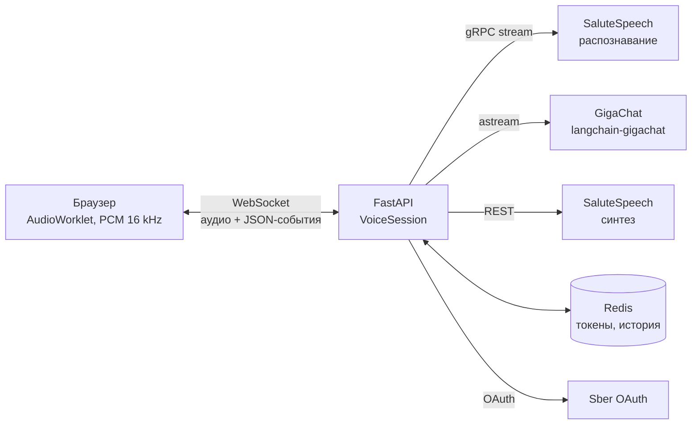
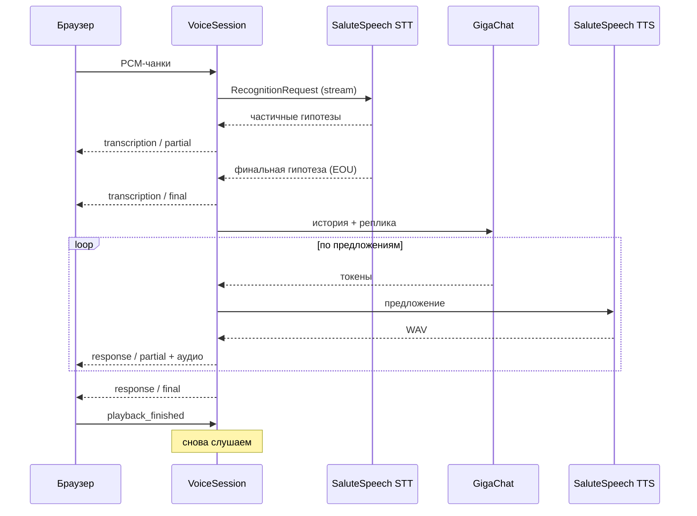

# voicebot — голосовой ассистент на SaluteSpeech и GigaChat

[](https://github.com/mellettan/sber_sst_ai_tts/actions/workflows/ci.yml)


Голосовой ассистент, который разговаривает в реальном времени: браузер стримит звук с микрофона по WebSocket, сервис распознаёт речь потоково через gRPC SaluteSpeech, получает ответ от GigaChat и озвучивает его через SaluteSpeech TTS. Ответ озвучивается по предложениям, не дожидаясь, пока LLM допишет его целиком.

## Возможности

- **Потоковое распознавание** — PCM 16 кГц уходит в SaluteSpeech через `grpc.aio` по мере записи, промежуточные гипотезы сразу отображаются у пользователя, конец фразы определяется на стороне SaluteSpeech (EOU).
- **Низкая задержка ответа** — токены GigaChat собираются в предложения, синтез каждого предложения запускается параллельно с генерацией следующего, аудио отдаётся клиенту по порядку. В логах пишется время от конца фразы до первого аудиочанка.
- **Память диалога** — история хранится в Redis по `session_id` с ограничением длины и TTL, поэтому разговор продолжается после переподключения и не привязан к конкретному воркеру.
- **Кэш OAuth-токенов** — токены Sber живут 30 минут; они хранятся в Redis и обновляются заранее, конкурентные запросы не порождают лишних вызовов OAuth.
- **Полудуплекс** — пока бот говорит, входящий звук отбрасывается, чтобы ассистент не распознавал сам себя.
- **Проверка TLS** — вместо `verify=False` используется корневой сертификат Минцифры, которым подписаны API Sber.

## Архитектура



Один ход диалога:



## Протокол WebSocket

Подключение: `ws://host:8000/ws/voice?session=<id>`. Без `session` создаётся новая сессия, её id приходит первым сообщением.

| Направление | Сообщение | Описание |
|---|---|---|
| клиент → сервер | бинарный фрейм | PCM S16LE, моно, 16 кГц |
| клиент → сервер | `{"type": "playback_finished"}` | клиент доиграл ответ, можно слушать дальше |
| сервер → клиент | `{"type": "session", "id": "..."}` | id сессии для переподключения |
| сервер → клиент | `{"type": "transcription", "status": "partial" \| "final", "text": "..."}` | распознанная речь |
| сервер → клиент | `{"type": "response", "status": "partial" \| "final", "text": "..."}` | ответ ассистента |
| сервер → клиент | бинарный фрейм | WAV с озвучкой очередного предложения |
| сервер → клиент | `{"type": "error", "text": "..."}` | ошибка, сессия продолжает работу |

## Запуск

Нужны ключи авторизации SaluteSpeech и GigaChat из [личного кабинета Studio](https://developers.sber.ru/studio).

```bash
cp .env.example .env
docker compose up --build
```

Открыть http://localhost:8000 и нажать «Начать разговор». Для доступа к микрофону с другого устройства нужен HTTPS (например, через reverse proxy).

Локально без Docker:

```bash
uv sync
docker run -d -p 6379:6379 redis:7.4-alpine
uv run voicebot
```

### Настройки

| Переменная | По умолчанию | Описание |
|---|---|---|
| `SALUTE_SPEECH_AUTH_KEY` | — | ключ авторизации SaluteSpeech (Basic) |
| `GIGACHAT_AUTH_KEY` | — | ключ авторизации GigaChat |
| `REDIS_URL` | `redis://localhost:6379/0` | Redis для токенов и истории |
| `GIGACHAT_MODEL` | `GigaChat` | модель: `GigaChat`, `GigaChat-Pro`, `GigaChat-Max` |
| `SYSTEM_PROMPT` | короткие ответы для озвучки | системный промпт |
| `TTS_VOICE` | `Bys_24000` | голос синтеза |
| `STT_HINTS` | `[]` | подсказки распознаванию: термины, имена |
| `STT_NO_SPEECH_TIMEOUT_SECONDS` | `7` | сколько ждать начала речи |
| `DIALOG_MAX_MESSAGES` | `20` | сколько реплик хранить в истории |
| `DIALOG_TTL_SECONDS` | `3600` | время жизни истории |
| `LOG_JSON` | `false` | логи в JSON для сборщика логов |

## Разработка

```bash
uv sync
uv run pytest
uv run ruff check . && uv run ruff format --check .
```

Тесты не ходят во внешние сервисы: распознавание проверяется против in-process gRPC-сервера с тем же контрактом, что у SaluteSpeech, OAuth — через `httpx.MockTransport`, Redis — через `fakeredis`, полный ход диалога — через WebSocket `TestClient` с фейковыми STT/TTS и `GenericFakeChatModel`.

gRPC-код генерируется из `proto/recognition.proto`:

```bash
./scripts/generate_proto.sh
```

## Структура

```
src/voicebot/
├── app.py              # сборка приложения, lifespan, WebSocket-эндпоинт
├── session.py          # VoiceSession: цикл слушать → думать → говорить
├── auth.py             # OAuth-токены Sber с кэшем в Redis
├── stt/recognizer.py   # потоковое распознавание через grpc.aio
├── tts.py              # синтез речи
├── dialog/
│   ├── model.py        # ответ LLM с учётом истории
│   ├── memory.py       # история диалога в Redis
│   └── sentences.py    # нарезка потока токенов на предложения
├── config.py           # настройки (pydantic-settings)
└── static/index.html   # веб-клиент
```

## Что дальше

- Перебивание бота голосом (barge-in) с локальным VAD на клиенте.
- Метрики Prometheus: задержка STT, LLM и TTS по отдельности.
- RAG по базе знаний через tool calling GigaChat.
